# IntelligentResidentialArea
智能化小区管理系统 小区物业管理系统 亮点：报修巡检闭环、能耗异常判别、ECharts运营分析、三角色业务协同、数据维护更方便； 角色：业主、物业、管理员；

所有源码均本人开发，项目是前后端分离的，所有的项目都具备了完整的业务逻辑，不仅仅局限于基础的增删改查（CRUD）操作，系统亮点众多。

本文注重于计算机毕业设计选题指导，列出题目均有源码， 大家可以去【公众号】(毕业终点站)获取或者加我【qq】(2112698948)提意见(别忘记Star哟)。备注：git

声明：仅用于学习使用，请勿用于任何商业行为！

1.系统非商用，非开源，非无偿。

2.由本人开发，如需源码，请联系以下方式，qq:2112698948。

3.项目有很多，并未全部上传，如果未找到想要的，可直接咨询。

# 智能化小区管理系统

> 业主 + 物业人员 + 管理员三角色协同的小区数字化平台。业主报事报修、缴费用能、访客车位一键办；物业接单巡检、回投诉收快递；管理员统管档案与八类业务统计，把小区日常运营搬到线上。

## 一、系统亮点

- **报修巡检全流程**：业主提交报修 → 管理员派工 → 物业上传处理结果 → 业主评价；巡检发现异常可一键转为维修工单，设施问题持续跟进不丢单。
- **能耗异常判别**：按同类用水、用电均值，将超过均值 2 倍的记录列入预警，展示房屋、用量与异常倍数，辅助物业排查漏水与用电异常。
- **ECharts 运营分析**：首页展示近 7 天业务趋势，八类统计页面覆盖缴费率、报修类型、投诉处理、巡检完成率、访客时段、车位使用率等指标，小区运行一目了然。
- **三角色业务协同**：业主办个人业务，物业处理分配任务，管理员维护档案并调度服务，配合账单、访客通行码、车位与快递记录减少重复沟通。
- **数据维护更方便**：支持业主及能耗 Excel 导入、账单等数据导出，配合展示层脱敏与可重复执行的演示数据脚本，方便项目演示与数据整理。

## 二、技术选型

| 层面 | 技术栈 |
| --- | --- |
| 前端 | Vue 3 + Vite + Element Plus + Vue Router + Pinia + Axios + ECharts + AiEditor |
| 后端 | Java + Spring Boot 3 + Spring MVC + MyBatis-Plus + MySQL + JWT |
| 工具 / 智能 | Apache POI（Excel 导入导出）+ DeepSeek 接口 |
| 环境 / 工具 | JDK 17、Maven、Node.js、IDEA、Windows |

## 三、角色与功能

| 角色 | 核心职责 |
| --- | --- |
| 业主 | 报事报修、费用查询与缴费、能耗查询、访客预约、车位、快递代收、投诉建议、便民电话 |
| 物业人员 | 处理报修工单、巡检任务、投诉回复、快递登记、访客登记、个人待办工作台 |
| 管理员 | 数据看板、账号 / 楼栋 / 房屋、报修 / 费用 / 巡检 / 能耗 / 投诉 / 访客 / 车位 / 快递 / 公告管理、八类业务统计 |

## 四、核心截图

### 系统总览

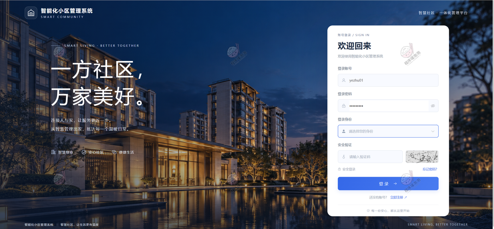

### 业主端

<table>
  <tr>
    <td width="50%"></td>
    <td width="50%">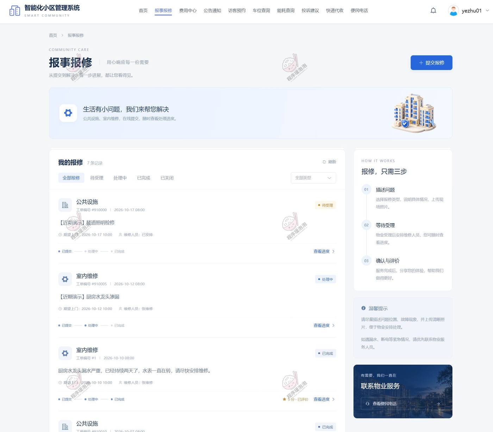</td>
  </tr>
  <tr>
    <td align="center"><b>① 小区首页</b></td>
    <td align="center"><b>② 报事报修</b></td>
  </tr>
  <tr>
    <td width="50%">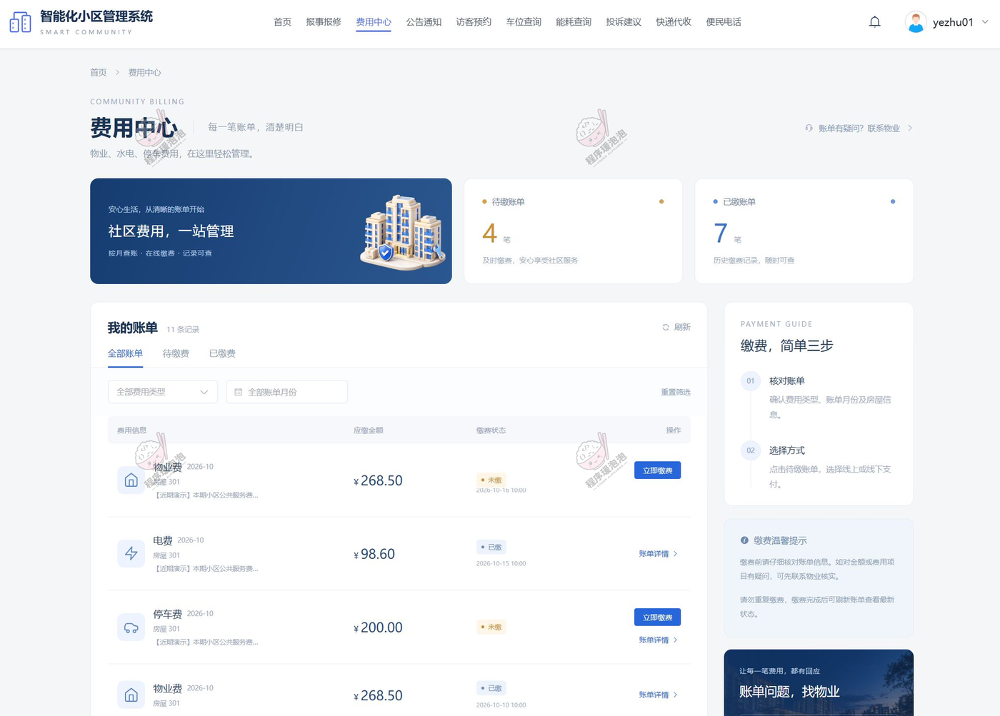</td>
    <td width="50%"></td>
  </tr>
  <tr>
    <td align="center"><b>③ 费用中心</b></td>
    <td align="center"><b>④ 公告通知</b></td>
  </tr>
  <tr>
    <td width="50%"></td>
    <td width="50%">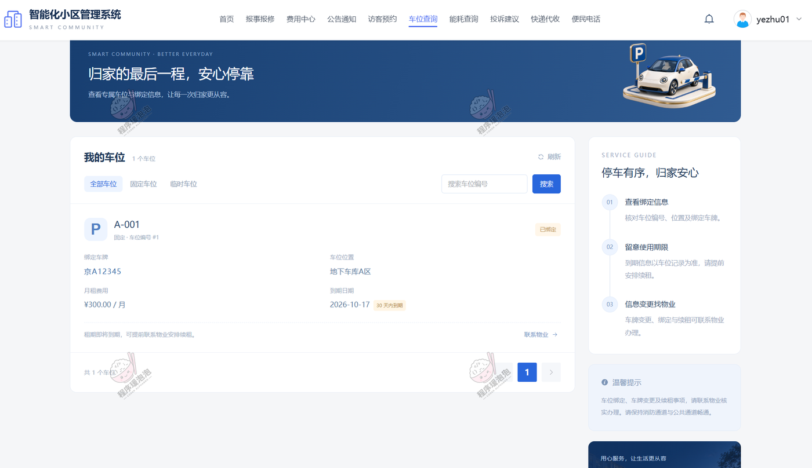</td>
  </tr>
  <tr>
    <td align="center"><b>⑤ 访客预约</b></td>
    <td align="center"><b>⑥ 车位查询</b></td>
  </tr>
  <tr>
    <td width="50%">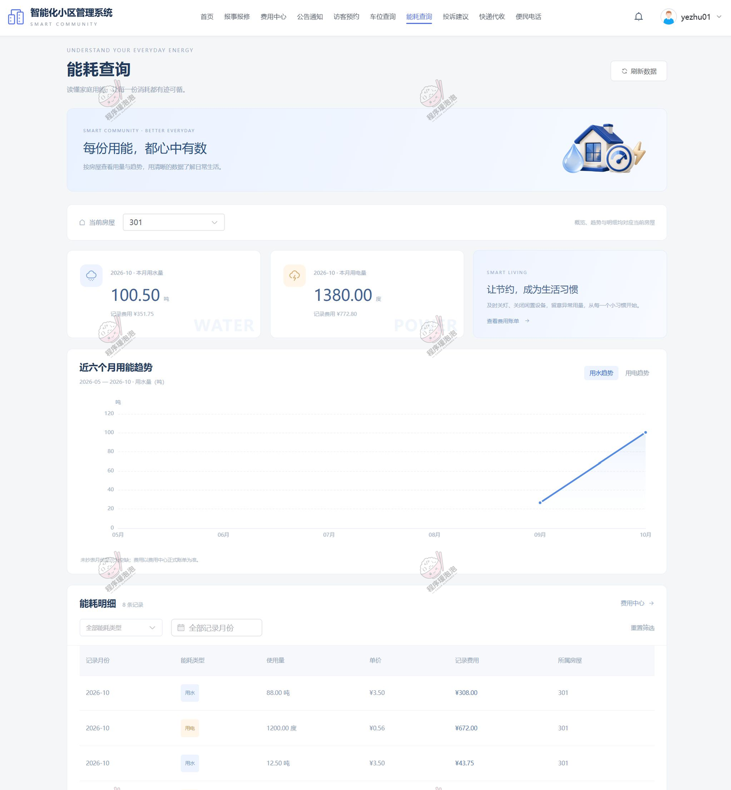</td>
    <td width="50%"></td>
  </tr>
  <tr>
    <td align="center"><b>⑦ 能耗查询 · 异常预警</b></td>
    <td align="center"><b>⑧ 投诉建议</b></td>
  </tr>
  <tr>
    <td width="50%"></td>
    <td width="50%"></td>
  </tr>
  <tr>
    <td align="center"><b>⑨ 快递代收</b></td>
    <td align="center"><b>⑩ 便民电话</b></td>
  </tr>
</table>

> **报事报修 / 费用中心 / 能耗查询**分别对应「报修巡检全流程」「数据维护更方便」「能耗异常判别」——报修全程跟踪，账单可查可缴，能耗页标出异常用量；**访客预约 / 车位 / 快递 / 投诉 / 公告 / 便民电话**覆盖了业主日常自助业务，体现「三角色业务协同」。

### 物业人员端

<table>
  <tr>
    <td width="50%"></td>
    <td width="50%">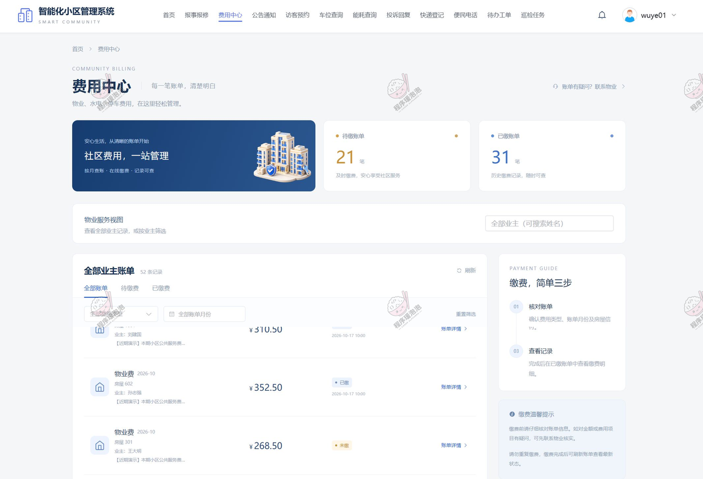</td>
  </tr>
  <tr>
    <td align="center"><b>① 报事报修 · 处理工单</b></td>
    <td align="center"><b>② 费用中心</b></td>
  </tr>
  <tr>
    <td width="50%"></td>
    <td width="50%"></td>
  </tr>
  <tr>
    <td align="center"><b>③ 访客预约</b></td>
    <td align="center"><b>④ 车位查询</b></td>
  </tr>
  <tr>
    <td width="50%"></td>
    <td width="50%"></td>
  </tr>
  <tr>
    <td align="center"><b>⑤ 投诉回复</b></td>
    <td align="center"><b>⑥ 快递登记</b></td>
  </tr>
  <tr>
    <td width="50%">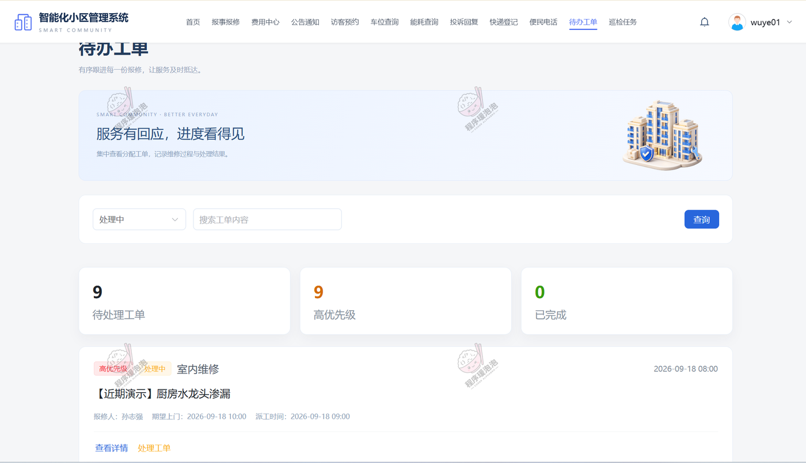</td>
    <td width="50%">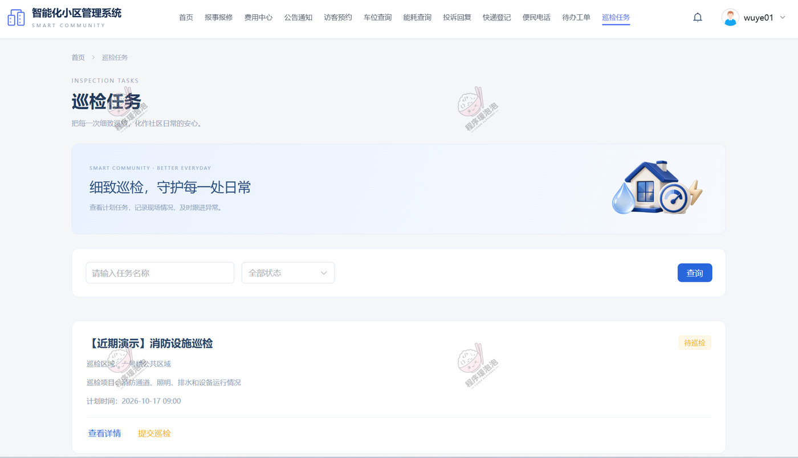</td>
  </tr>
  <tr>
    <td align="center"><b>⑦ 待办工单 · 工作台</b></td>
    <td align="center"><b>⑧ 巡查任务</b></td>
  </tr>
</table>

> 物业侧围绕「接单—处理—反馈」展开：报修工单、巡查任务、投诉回复、快递登记都在分配范围内，对应「报修巡检全流程」「三角色业务协同」。

### 管理员端

**① 车位信息**
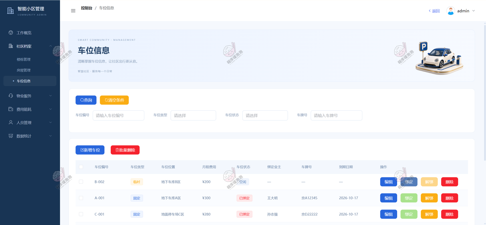

**② 保修工单 · 派工与跟踪**
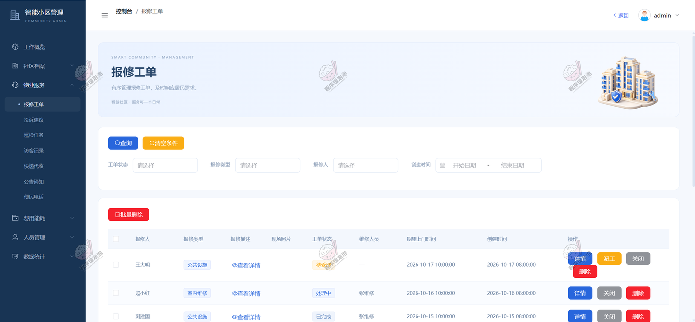

> 管理员派工、跟踪处理进度、查看完工结果与业主评价，对应「报修巡检全流程」。

**③ 投诉建议**
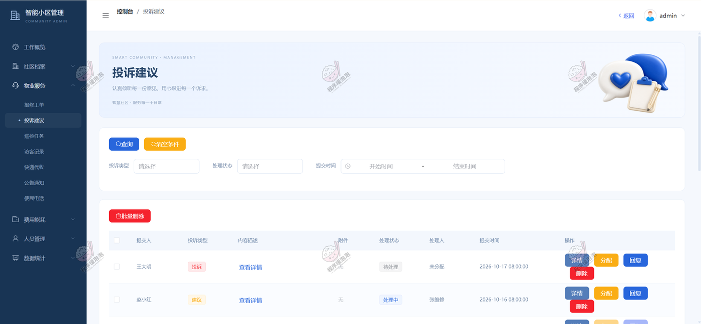

**④ 巡检任务 · 异常转工单**
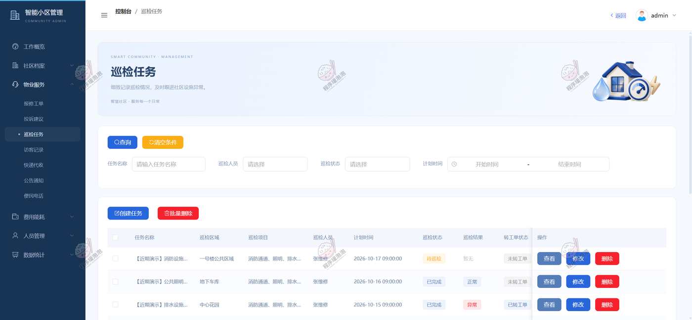

**⑤ 访客记录**
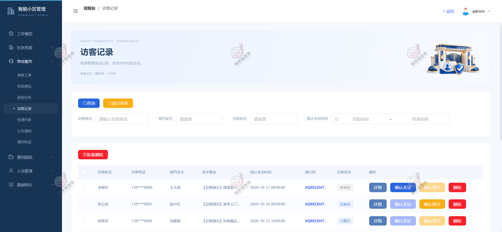

**⑥ 快递代收**
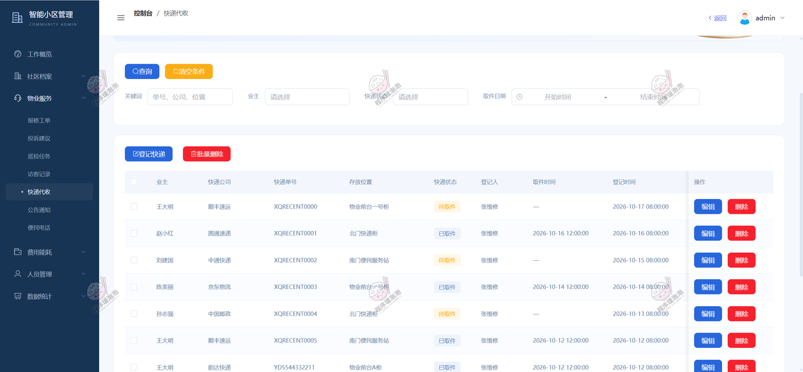

**⑦ 费用账单 · 批量生成与导出**
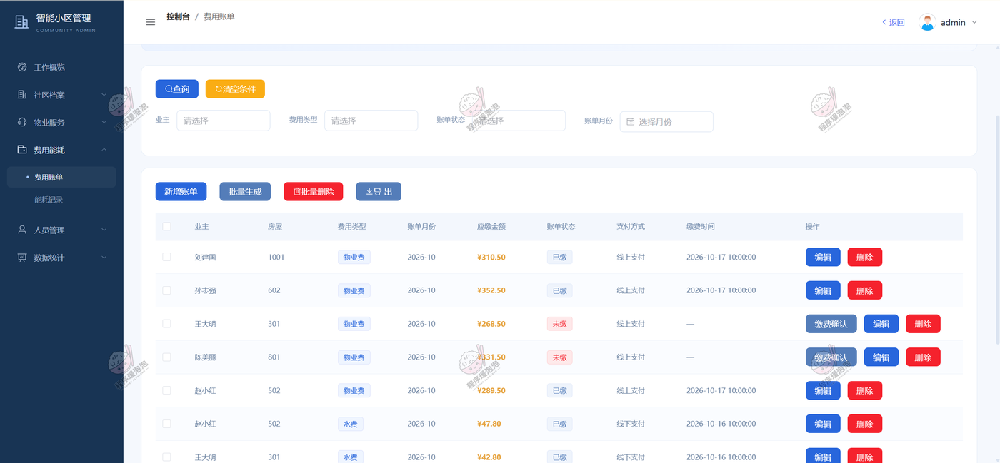

> 账单支持批量生成月度账单、确认缴费与导出，对应「数据维护更方便」。

**⑧ 数据分析 · 八类统计看板**
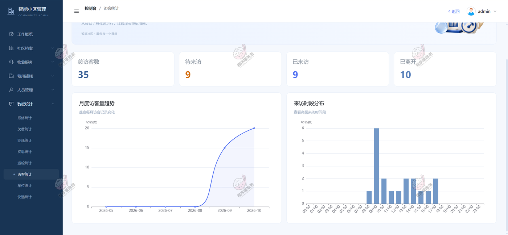

> 缴费率、报修类型、投诉处理、巡检完成率、访客时段、车位使用率等八类图表，对应「ECharts 运营分析」。

---

> 文档展示 27 张截图，需要了解更多，请联系我。
